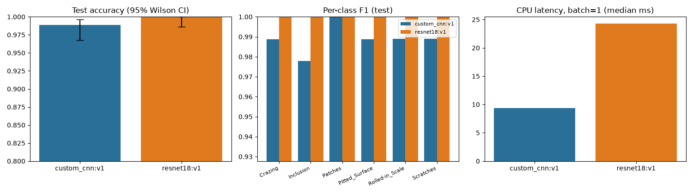
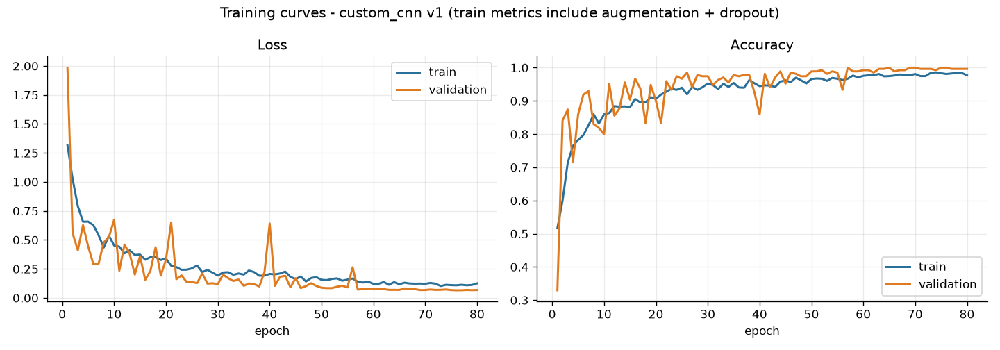
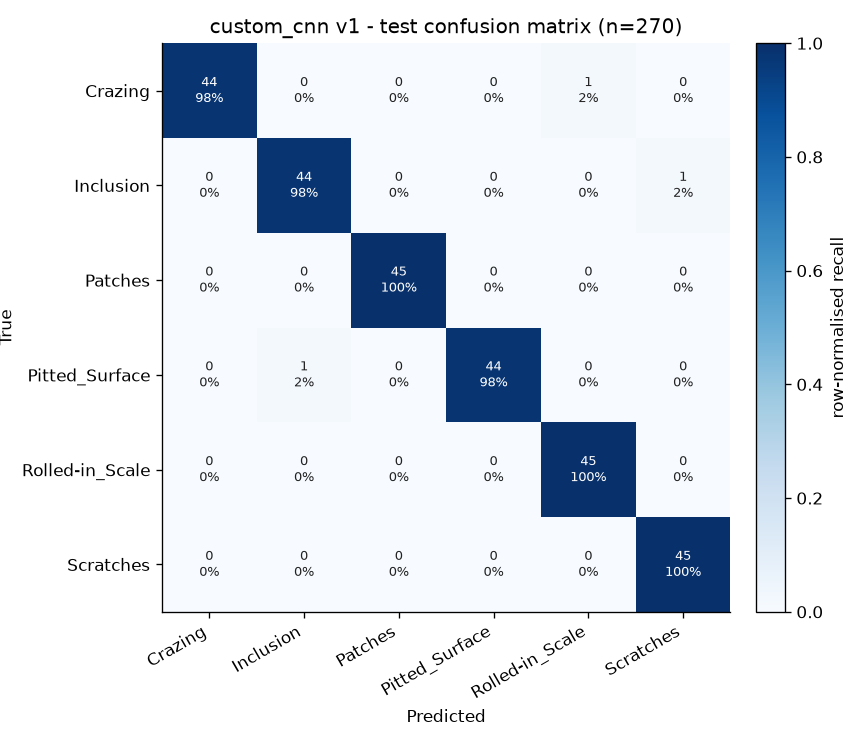
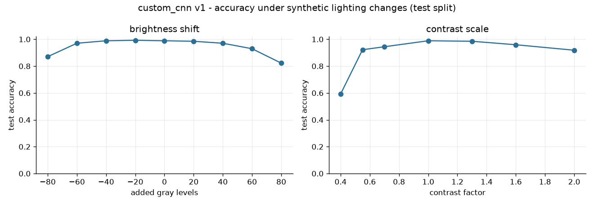
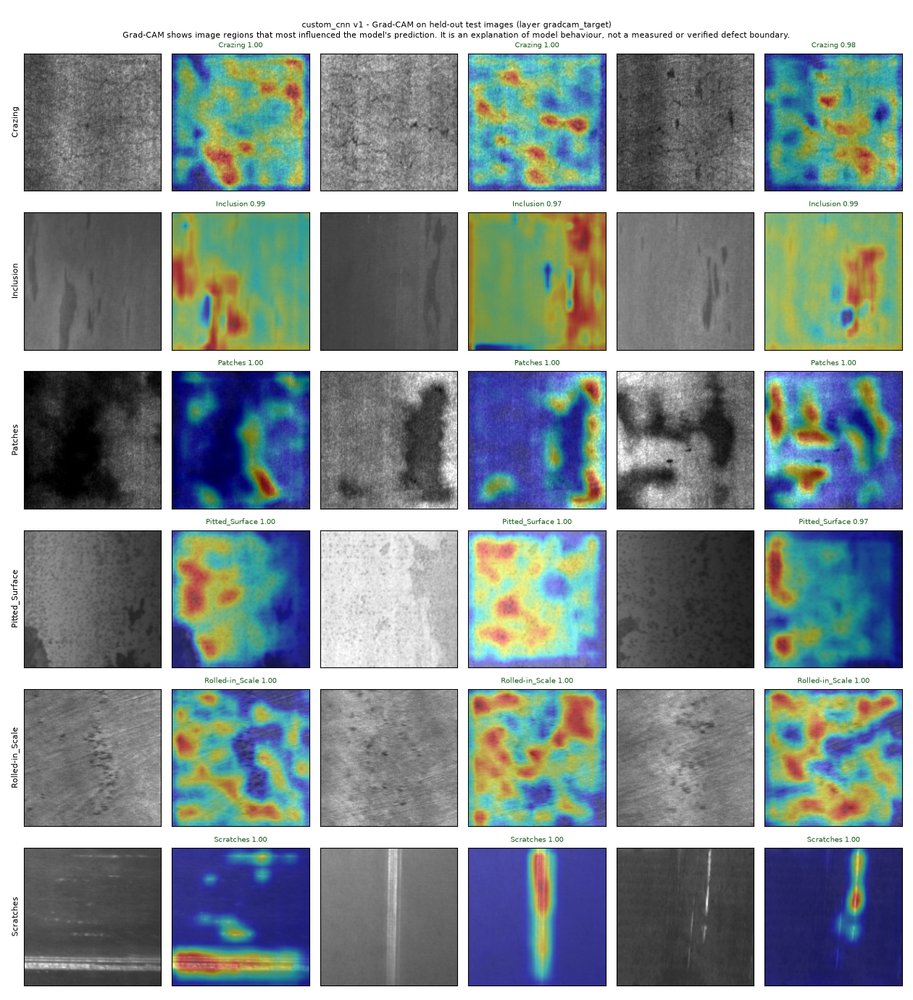
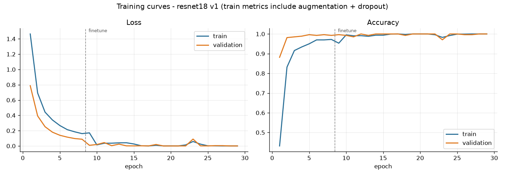
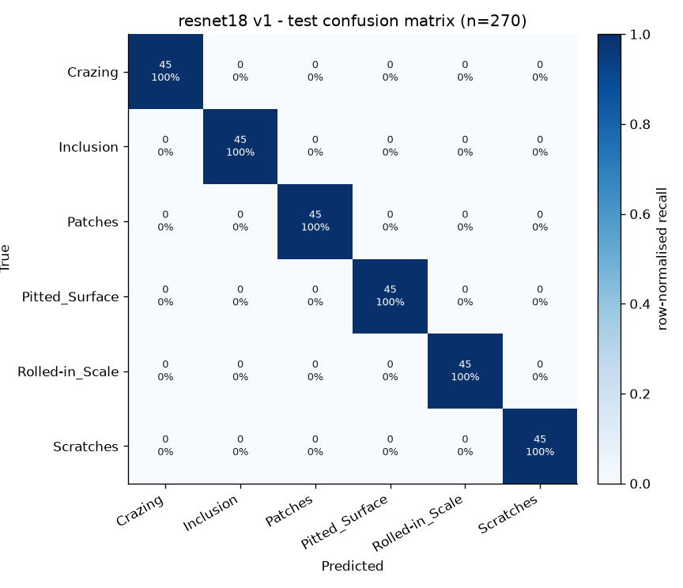
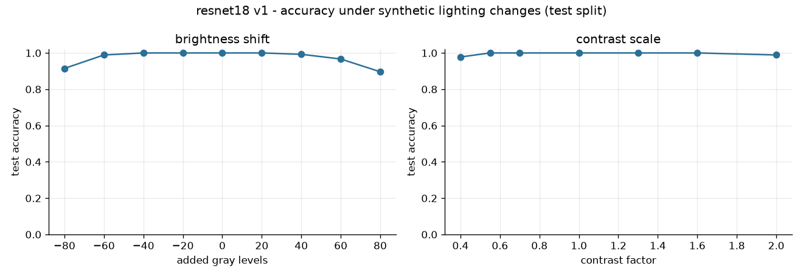
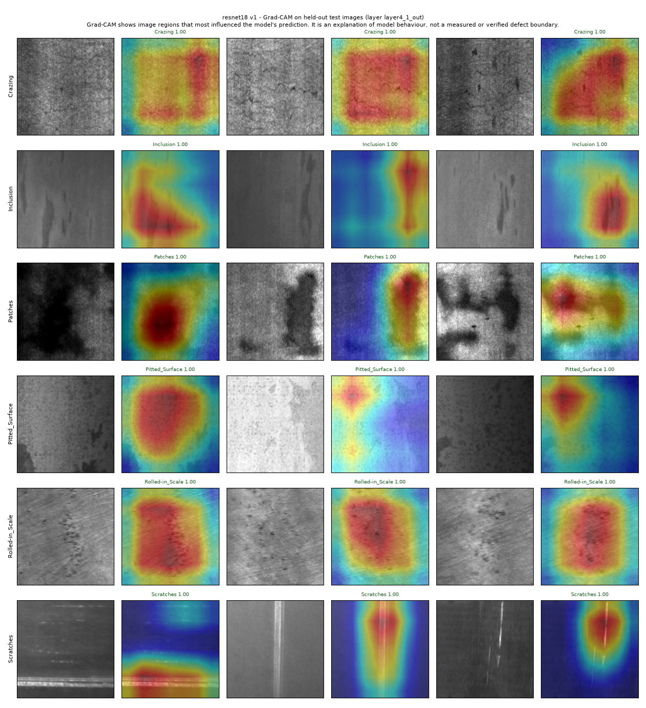

# COCO SurfaceCheck — Final Technical Report
_Generated 2026-11-10 22:39 UTC by `training/build_report.py` from pipeline artefacts._

> **Scope.** Academic prototype on the NEU-CLS benchmark. All metrics below come from actual model execution on a held-out test split (n = 270). They describe benchmark performance and are **not** estimates of production-line performance. The production-line mode is a simulated playback of stored images.

## 1. Dataset
- Source: Hugging Face mirror `newguyme/neu_cls` (label names verified **visually**; see DECISIONS D-005/D-007).
- Validation: **PASS** — 1800 images, sizes {'200x200': 1800}, modes {'L': 1800}.
- Exact duplicate groups: 1 (kept together in one split); near-duplicate pairs: 0.
- Split (seed 42): train/val/test = 1260/270/270, stratified, group-aware. Leakage check: **no overlap** in files, pixel hashes or duplicate groups.
- Normalisation statistics from train only: mean 0.5044, std 0.2107.

**Shortcut analysis.** Mean brightness per class (train) ranges from 96.54 to 177.55 gray levels. A logistic regression on only per-image mean+std reaches **63.70%** test accuracy (32-bin histogram: 61.85%; chance 16.67%). Global exposure alone separates much of NEU-CLS, which motivates brightness/contrast augmentation and the robustness tests below.

## 2. Models
- **custom_cnn** — 423,462 parameters; trained 70.2 min on CPU (TensorFlow 2.20.0, seed 42). Stages: full: 80 epochs, best epoch 76, 422,502 trainable params, 52.6 s/epoch.
- **resnet18** — 11,189,190 parameters; trained 20.8 min on CPU (TensorFlow 2.20.0, seed 42). Stages: head: 8 epochs, best epoch 8, 3,078 trainable params, 27.8 s/epoch; finetune: 21 epochs, best epoch 21, 10,488,838 trainable params, 48.9 s/epoch.
- ResNet18 ImageNet weights ported from torchvision 0.29.2+cpu, ResNet18_Weights.IMAGENET1K_V1; verification on 14 inputs: max |Δlogit| = 1.75e-05, top-1 agreement 100%, passed = True.

## 3. Results on the held-out test split
| Metric | custom_cnn:v1 | resnet18:v1 |
|---|---:|---:|
| Parameters | 423,462 | 11,189,190 |
| Model file incl. optimizer state (MB) | 5.17 | 128.99 |
| Training time (min, shared CPU, not a controlled benchmark) | 70.2 | 20.8 |
| Validation accuracy | 1.0000 | 1.0000 |
| Test accuracy [95% CI] | 0.9889 [0.968, 0.996] | 1.0000 [0.986, 1.000] |
| Test macro-F1 [95% CI] | 0.9889 [0.975, 1.000] | 1.0000 [1.000, 1.000] |
| Test errors (of 270) | 3 | 0 |
| F1 Crazing | 0.989 | 1.000 |
| F1 Inclusion | 0.978 | 1.000 |
| F1 Patches | 1.000 | 1.000 |
| F1 Pitted_Surface | 0.989 | 1.000 |
| F1 Rolled-in_Scale | 0.989 | 1.000 |
| F1 Scratches | 0.989 | 1.000 |
| Latency batch=1 median / p95 (ms) | 9.4 / 10.2 | 24.3 / 25.9 |
| Throughput batch=32 (img/s) | 154 | 67 |
| Robustness acc (brightness_shift=-60) | 0.970 | 0.989 |
| Robustness acc (brightness_shift=60) | 0.930 | 0.967 |
| Robustness acc (contrast_scale=0.55) | 0.922 | 1.000 |
| Robustness acc (contrast_scale=1.6) | 0.959 | 1.000 |
| Policy automation rate (test) | 0.648 | 0.667 |
| Accuracy of auto-decided (test) | 0.9943 | 1.0000 |
| Escaped reject-class defects | 0 | 0 |
| False rejects | 0 | 0 |

McNemar exact test: only custom_cnn:v1 correct = 0, only resnet18:v1 correct = 3, p = 0.2500 (not significant at 0.05).

_Measured on the NEU-CLS academic benchmark (held-out test split, n=270). Not an estimate of performance on a production line._

### custom_cnn
Test accuracy **98.89%** (95% Wilson CI 96.78%–99.62%), macro-F1 **0.9889** (bootstrap CI 0.975–1.000), 3 errors of 270. Validation accuracy 100.00%.

| Class | Precision | Recall | F1 | Support |
|---|---:|---:|---:|---:|
| Crazing | 1.000 | 0.978 | 0.989 | 45 |
| Inclusion | 0.978 | 0.978 | 0.978 | 45 |
| Patches | 1.000 | 1.000 | 1.000 | 45 |
| Pitted_Surface | 1.000 | 0.978 | 0.989 | 45 |
| Rolled-in_Scale | 0.978 | 1.000 | 0.989 | 45 |
| Scratches | 0.978 | 1.000 | 0.989 | 45 |

CPU latency (forward pass): batch 1 median 9.38 ms (p95 10.20 ms); batch 32 throughput 154 img/s on `Intel64 Family 6 Model 165 Stepping 2, GenuineIntel`.
Robustness (synthetic lighting): brightness −80/−40/+40/+80 → 87.0% / 98.9% / 97.0% / 82.2%; contrast ×0.4/×2.0 → 59.3% / 91.9%.
Decision engine (policy v1.0): {'PASS_CANDIDATE': 45, 'REJECT_CANDIDATE': 130, 'MANUAL_REVIEW': 95}; automation rate 64.8%; accuracy of auto-decided items 99.43%; misclassifications caught by review 2/3; escaped reject-class defects 0; false rejects 0.
Grad-CAM sanity check: Spearman ρ trained-vs-random-weights 0.065; flip consistency 0.734 (n=60).

### resnet18
Test accuracy **100.00%** (95% Wilson CI 98.60%–100.00%), macro-F1 **1.0000** (bootstrap CI 1.000–1.000), 0 errors of 270. Validation accuracy 100.00%.

| Class | Precision | Recall | F1 | Support |
|---|---:|---:|---:|---:|
| Crazing | 1.000 | 1.000 | 1.000 | 45 |
| Inclusion | 1.000 | 1.000 | 1.000 | 45 |
| Patches | 1.000 | 1.000 | 1.000 | 45 |
| Pitted_Surface | 1.000 | 1.000 | 1.000 | 45 |
| Rolled-in_Scale | 1.000 | 1.000 | 1.000 | 45 |
| Scratches | 1.000 | 1.000 | 1.000 | 45 |

CPU latency (forward pass): batch 1 median 24.28 ms (p95 25.93 ms); batch 32 throughput 67 img/s on `Intel64 Family 6 Model 165 Stepping 2, GenuineIntel`.
Robustness (synthetic lighting): brightness −80/−40/+40/+80 → 91.5% / 100.0% / 99.3% / 89.6%; contrast ×0.4/×2.0 → 97.8% / 98.9%.
Decision engine (policy v1.0): {'PASS_CANDIDATE': 45, 'REJECT_CANDIDATE': 135, 'MANUAL_REVIEW': 90}; automation rate 66.7%; accuracy of auto-decided items 100.00%; misclassifications caught by review 0/0; escaped reject-class defects 0; false rejects 0.
Grad-CAM sanity check: Spearman ρ trained-vs-random-weights 0.200; flip consistency 0.932 (n=60).

## 4. Limitations
- No defect-free class: the system classifies defect *type*; it cannot certify a clean surface (decision policy is illustrative).
- Single small benchmark from one acquisition setup; label names of the mirror verified visually.
- Grad-CAM is a coarse explanation of model behaviour, not a defect segmentation.
- Latency is CPU software timing on one laptop; there is no camera/conveyor integration and no real-time guarantee.
- Deployment would require plant-specific data, re-validation, calibration of thresholds, and drift monitoring.
